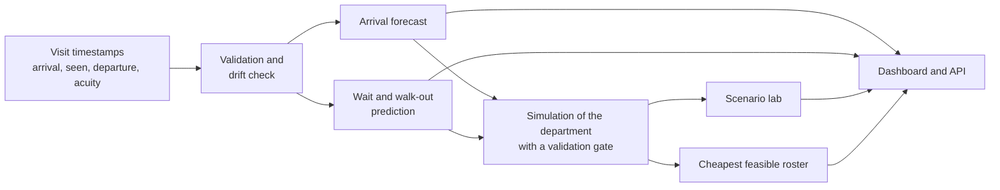

# ED Intelligence

### Intelligent Emergency Department Management and Waiting-Time Optimization

**Know who will wait, how long, and how many staff it takes to fix it, before the waiting room fills.**

An end-to-end decision-support system for emergency department (ED) operations. It forecasts arrivals, predicts each patient's wait with a calibrated interval, tests staffing changes in a simulated copy of the department, and recommends the cheapest roster that meets wait targets, all behind a hospital-style dashboard and a REST API.

It supports the people who run the department. It does not triage patients or make clinical decisions.

> **Status:** validated on synthetic data, with the forecasting module also validated on six years of real hourly arrivals from a US academic ED. Ready for a pilot on your own timestamps. See [What is proven and what is not](#what-is-proven-and-what-is-not).

---

## Why this project exists

An ED runs on three decisions that are usually made separately and by feel:

1. **How many patients are coming?** Rosters are set before the shift, not after the surge.
2. **How long will this person wait?** Patients hear "soon", and some leave without being seen.
3. **What would one more doctor, nurse or fast-track lane actually change?** Nobody can try it on a live department.

Most tools answer one of these. Here the arrival forecast drives the simulation, the simulation drives the staffing search, and the same queue state feeds the patient-level wait prediction. The three are connected on purpose.

## Results at a glance

| Question | What the system gives | Result |
|---|---|---|
| How busy will it be? | Hourly arrival forecast with a 90% interval | MAE **2.36 vs 2.98** for the seasonal baseline (**20.9% better**). On real hourly arrivals from a US academic ED: **26.4% better**, 89.8% interval coverage |
| How long will this patient wait? | Predicted wait with an interval, plus risk of a prolonged wait or of leaving unseen | MAE **11.5 vs 34.2 min** against the best simple baseline (**66% lower**) |
| What should we change? | Side-by-side scenarios with confidence intervals | Table below |
| What is the cheapest safe roster? | Search over 144 weekly rosters, judged on the upper confidence bound | **3 / 3 / 2 / 2** doctors at **49,280** per 168-hour week; 72 of 144 plans met the targets |

### What a manager can try

Results on the synthetic department. Read the direction and relative size, not the exact minutes.

| Scenario | Mean wait | Change vs today | Walk-outs |
|---|---|---|---|
| Today | 33.9 min | n/a | 3.4% |
| One more doctor at peak | 20.8 min | **-13.1 min** (CI -14.0 to -12.2) | 1.7% |
| One more nurse at peak | 26.9 min | -7.0 min | 2.2% |
| Fast-track lane for ESI 4-5 | 8.1 min | **-25.7 min** | 0.1% |
| Demand surge +10% | 47.7 min | +13.9 min | 6.6% |
| Demand surge +20% | 60.8 min | +26.9 min | 10.6% |

A fast-track lane does more than any single hire, and a 20% surge nearly doubles the mean wait. That is the trade-off the system is built to show before money is spent.

Run on two further generated files, the effects held in direction and size (a busier department gained more from the same changes), which is evidence the pipeline adapts to a new extract rather than memorising one.

---

## What makes it different

Most ED projects stop at an accuracy number. This one is built to say when it should not be believed.

- **Honest uncertainty.** Prediction intervals are recalibrated from patients already seen at the moment a new patient arrives (rolling conformal). Coverage on the test period is 88.8% against a 90% target, versus 84.9% for one-time calibration. On one of the two extra test files the two methods tied, and the report says so.
- **A gate before any scenario runs.** The simulation must first reproduce the observed department's waits and walk-outs. If it cannot, scenarios refuse to run. Across 10 regenerated datasets the gate passed 8 and refused 2, which is the behaviour you want from a safety check.
- **No peeking at the future.** A leakage test rebuilds every feature on data cut off at each moment and requires identical results.
- **Paired scenario comparisons.** Scenarios use common random numbers, so shared noise cancels and the differences carry tight intervals.
- **Competing risks done properly.** Leaving without being seen is an event, not censoring. Kaplan-Meier overstates the chance of being seen by up to 5% (typical file) and 9% (busy file); the Aalen-Johansen estimate corrects it. Proportional-hazards assumptions are tested and the failures are reported.
- **Reported weaknesses.** At the busiest hours the main-run forecast is 6.4% worse than the baseline. High-acuity patients get no usable prolonged-wait warning under a single threshold. A reinforcement-learning staffing agent was built, lost to the fixed roster, and is reported as a negative result.
- **Subgroup checks.** Error and miss rates are reported by acuity, sex, arrival mode and age band with confidence intervals, and marked where there are too few cases to judge.
- **Every number in the documentation is audited.** A script checks the quoted figures against the artifacts the pipeline wrote.

## What is proven and what is not

| Claim | Evidence |
|---|---|
| The forecasting method works on a real hospital's data | Six years of real hourly arrivals (University of Iowa Hospital, 41,640 hours), 26 rolling origins, unchanged model |
| The pipeline reads real ED extracts | MIT MIMIC-IV-ED demo (222 stays) loads through the adapter; no model is fitted on it |
| Wait prediction, queue features and the staffing search work | Synthetic data only. The generator simulates a queue, so this shows the method works, not that it will on your department |
| The staffing recommendation is independent evidence | **No.** It is partly circular on synthetic data, because the generating roster is also the cheapest feasible one. It needs a department that changed its roster to test properly |

Open real data cannot validate the queue features: MIMIC-IV-ED has no provider-contact time and shifts dates per patient, so the department's queue cannot be rebuilt. That is why the pilot below needs your own timestamps.

---

## Architecture



| Layer | What it does |
|---|---|
| Data | Schema validation, time-ordered train / validation / calibration / test blocks, drift check against the reference data |
| Forecasting | LightGBM with calendar and lag features (including 168 h), rolling-origin backtest against seasonal-naive |
| Wait prediction | Base vs base + queue-state features (a controlled ablation), conformal intervals, prolonged-wait classifier |
| Survival | Kaplan-Meier vs Aalen-Johansen, cause-specific Cox models, proportional-hazards tests |
| Simulation | SimPy discrete-event model, common random numbers, validation gate |
| Staffing | Search over 144 weekly rosters on the upper confidence bound |
| Serving | FastAPI (`/health`, `/predict-wait`, `/forecast`, `/simulate`, `/staffing-recommendation`, `/predict-risk`, `/v1/analytics/*`, `/v1/board`, `/v1/meta`), Streamlit dashboard, upload job engine, Docker |

You need only six columns to start: patient ID, arrival time, triage level, time first seen, departure time and disposition. Age, sex, arrival mode and complaint are optional.

---

## Run it in two clicks (Windows)

1. First time on a machine: double-click **`Setup.cmd`** (creates `.venv` and installs pinned dependencies; takes a few minutes, once).
2. Double-click **`Start-Demo.cmd`**. It checks the environment, starts the API and the dashboard, waits for both, and opens your browser.
3. Double-click **`Stop-Demo.cmd`** when you are done.

```
Dashboard: http://localhost:8501
API docs:  http://localhost:8000/docs
```

Both services bind to `127.0.0.1` only. The launcher never kills a process to free a port: if something else holds port 8000 or 8501, it tells you what and stops. If the trained models are missing it names the one command that produces them instead of silently training.

### The dashboard

- **Command center:** expected arrivals, busiest hour, typical wait, congestion risk and alerts.
- **Patient flow board:** replay a historical day and see who is waiting, with predicted waits and intervals.
- **Staffing planner:** the recommended roster and every feasible alternative.
- **Scenario lab:** try a doctor, a nurse, a fast-track lane or a demand surge.
- **Model quality:** results with their baselines and intervals.
- **Data upload:** drop in your own extract and the full analysis runs automatically, ending in a report.

---

## Engineering notes

- **Tests:** more than 1,300 automated tests, including leakage, API-contract, launcher, and headline-result regression tests that fail if a published number drifts.
- **Reproducibility:** fixed seeds, pinned dependencies, and the data generator reproduces the reference dataset byte for byte.
- **Robustness study:** the whole pipeline was rerun on 10 regenerated datasets. The gate passed 8 of 10; the cheapest roster varied (cost range 43,890 to 54,670 over 7 distinct rosters), so the method transfers while the specific roster does not.
- **Real-data checks:** forecasting validated on six years of open hourly ED arrivals; the MIMIC-IV-ED demo is used for adapter testing only.
- **Known limits:** unmodelled resources (nurses, beds, imaging are not hard constraints in the base model); the treatment/boarding split is not identifiable from timestamps alone; the abandonment gate is deliberately loose because the counts are small; per-acuity targets used for high-acuity warnings are illustrative, not clinical standards.

## A pilot, if you want one

| Phase | What happens | What you provide |
|---|---|---|
| 1. Fit check (about 1 week) | Run your extract through validation and the drift check | 6-12 months of visit timestamps, no names |
| 2. Retrain and validate (2-3 weeks) | Retrain on your data, re-run the simulation gate, report intervals and subgroup results honestly | Your current roster by shift |
| 3. Shadow mode (4-8 weeks) | Predictions run beside the department and are scored against what actually happened, with no operational use | A read-only daily feed |
| 4. Decide | Go / no-go on evidence from your own department | Your wait targets |

What it will not do: triage patients, allocate care, or run without a human reviewing the output.

## Tech stack

Python 3.12, LightGBM, SimPy, lifelines, scikit-learn, pandas, FastAPI, Streamlit, Docker, pytest.

## Data and credits

- **Synthetic data:** generated by a documented queue simulator with realism-calibrated parameters. It is not real patient data.
- **MIMIC-IV-ED demo** (MIT / PhysioNet, ODbL): adapter testing only.
- **University of Iowa Hospital hourly ED arrivals** from the `fastTS` R package (GPL-3): forecast validation. The raw file is not redistributed here.

Full credits and licences are in `SUBMISSION.md`.

---

**Decision support only. Synthetic data. Not for clinical use.**

*Authors: Omkar Armugam and team.*
